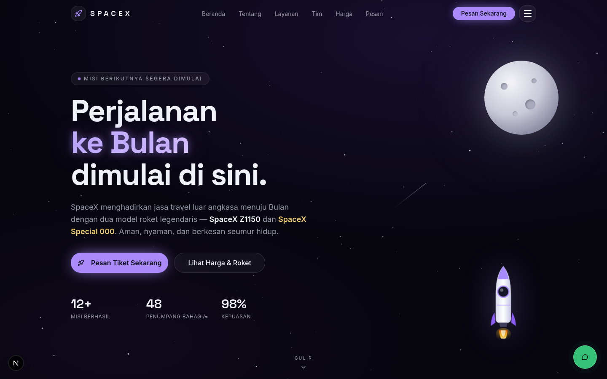
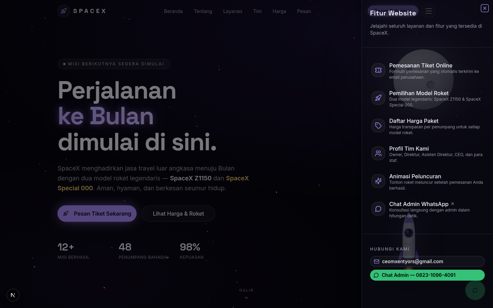
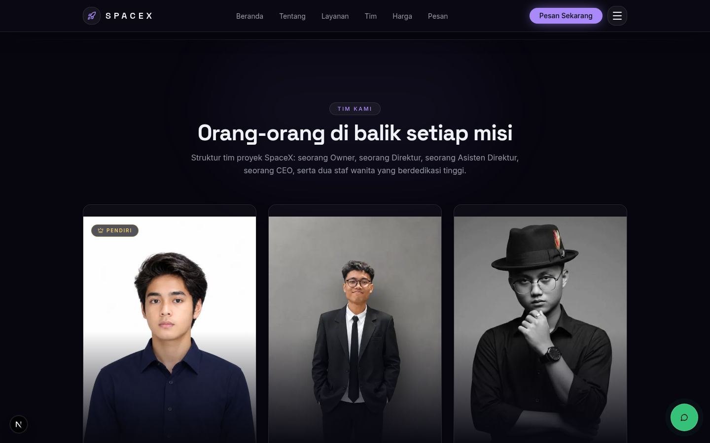
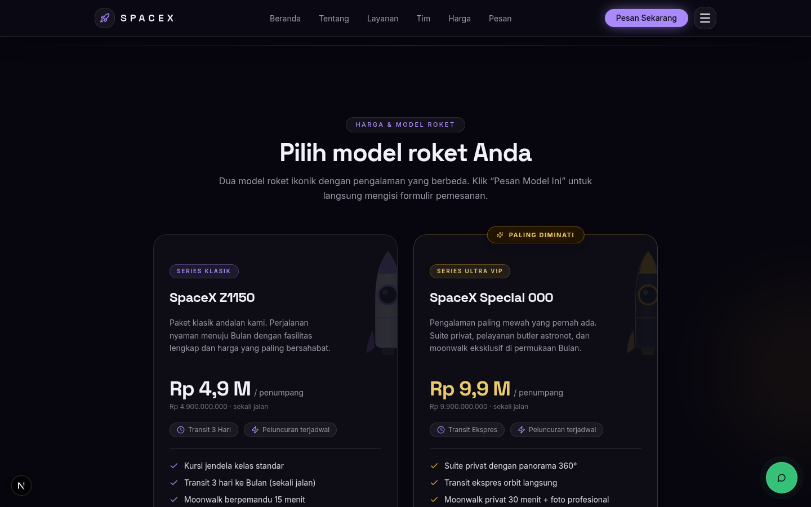
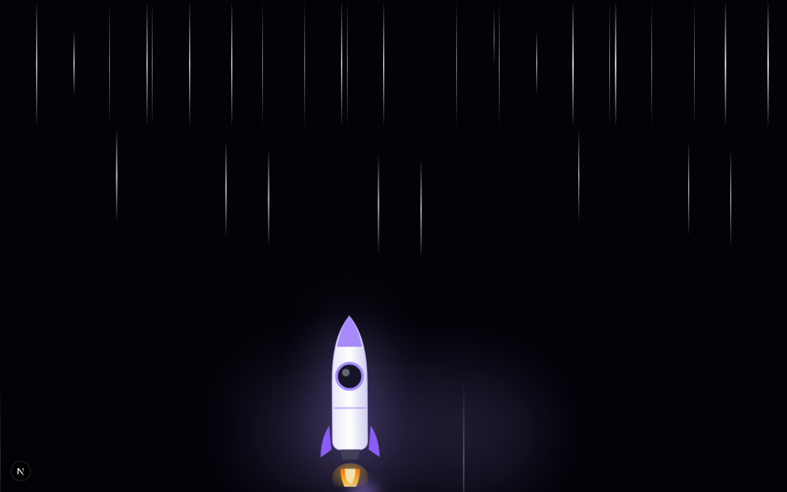
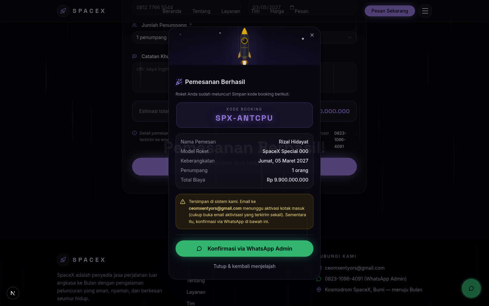
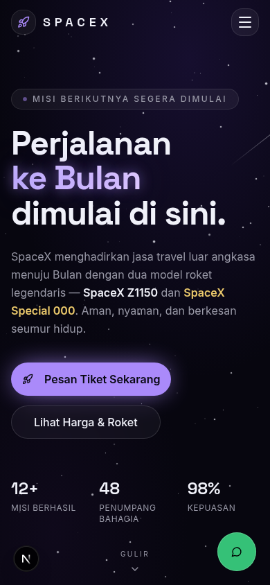

# 🚀 SpaceX — Jasa Travel ke Bulan

Website **company profile** untuk perusahaan fiktif **SpaceX Travel** — penyedia jasa
perjalanan luar angkasa ke Bulan. Dibangun dengan desain *minimalis deep-space* yang
gelap, aesthetic, dan penuh animasi halus bertema angkasa.



## ✨ Fitur

| Fitur | Keterangan |
| --- | --- |
| 🎬 **Transisi pembuka (intro)** | Layar penyambung dengan logo & garis progres yang memudar mulus ke halaman utama |
| 🧭 **Navbar di atas header** | Navbar *fixed* dengan efek kaca (glassmorphism), makin solid saat halaman digulir |
| ☰ **Menu garis-3 (hamburger)** | Tombol di **pojok kanan atas** membuka drawer berisi fitur-fitur website + kontak cepat |
| 👥 **Profil tim** | 1 Owner, 1 Direktur, 1 Asisten Direktur, 1 CEO, dan 2 staf wanita — lengkap dengan foto |
| 🚀 **Dua model roket** | **SpaceX Z1150** (Series Klasik — Rp 4,9 M) dan **SpaceX Special 000** (Ultra VIP — Rp 9,9 M) |
| 💳 **Formulir pemesanan online** | Validasi lengkap + estimasi harga real-time + pilihan model roket |
| 📧 **Pemesanan otomatis ke email** | Detail pemesanan terkirim otomatis ke `ceomxentyors@gmail.com` (via FormSubmit) |
| 💬 **Chat admin WhatsApp** | Tombol mengambang + tautan pesan-terisi ke `0823-1096-4091` |
| 🎆 **Animasi roket terbang** | Hitung mundur 3‑2‑1, roket meluncur dengan efek *warp* bintang setiap pemesanan berhasil |
| ✅ **Dialog konfirmasi** | Kode booking unik (format `SPX-XXXXXX`), ringkasan pesanan, dan tombol konfirmasi WhatsApp |
| 📱 **Responsif penuh** | Tata letak mobile-first, aman untuk layar kecil |

## 🖼️ Cuplikan Layar

| Menu Fitur (garis-3) | Tim Kami |
| --- | --- |
|  |  |

| Harga & Model Roket | Animasi Peluncuran |
| --- | --- |
|  |  |

| Dialog Sukses | Tampilan Mobile |
| --- | --- |
|  |  |

## 🛠️ Teknologi

- **[Next.js 16](https://nextjs.org/)** (App Router) + **TypeScript**
- **Tailwind CSS 4** + **shadcn/ui** (komponen New York style)
- **Framer Motion** — animasi entrance, scroll-reveal, dan peluncuran roket
- **React Hook Form + Zod** — validasi formulir pemesanan
- **Prisma ORM + SQLite** — penyimpanan pemesanan
- **FormSubmit** — pengiriman email pemesanan tanpa kredensial SMTP
- **Lucide Icons**

## 📁 Struktur Proyek

```
spacex-travel/
├── docs/screenshots/          # Cuplikan layar untuk README
├── prisma/schema.prisma       # Skema database (model Booking)
├── public/
│   ├── team/                  # Foto 6 anggota tim (600×800, teroptimasi)
│   └── favicon.svg            # Ikon roket
├── scripts/                   # Skrip utilitas (optimasi foto tim)
├── src/
│   ├── app/
│   │   ├── api/booking/route.ts   # API pemesanan: validasi → DB → email
│   │   ├── globals.css        # Tema space gelap + animasi kustom
│   │   ├── layout.tsx         # Metadata & font (Space Grotesk + Inter)
│   │   └── page.tsx           # Halaman utama (susunan section)
│   ├── components/spacex/     # Seluruh komponen website
│   │   ├── Navbar.tsx             # Navbar + menu hamburger fitur
│   │   ├── IntroOverlay.tsx       # Transisi pembuka
│   │   ├── Starfield.tsx          # Bintang berkedip + bintang jatuh
│   │   ├── HeroSection.tsx        # Hero: Bulan, roket melayang, statistik
│   │   ├── AboutSection.tsx       # Tentang perusahaan
│   │   ├── FeaturesSection.tsx    # Layanan
│   │   ├── TeamSection.tsx        # Profil tim (6 anggota)
│   │   ├── PricingSection.tsx     # Harga & 2 model roket
│   │   ├── BookingSection.tsx     # Formulir pemesanan
│   │   ├── RocketLaunchOverlay.tsx# Animasi roket terbang
│   │   ├── SuccessDialog.tsx      # Dialog konfirmasi booking
│   │   ├── WhatsAppFloat.tsx      # Tombol WhatsApp mengambang
│   │   └── Footer.tsx             # Footer
│   ├── config/
│   │   ├── site.ts            # Kontak, email, WhatsApp, navigasi
│   │   ├── team.ts            # Data 6 anggota tim ← ubah nama di sini
│   │   └── rockets.ts         # Model roket & daftar harga ← ubah harga di sini
│   ├── store/launch-store.ts  # State animasi peluncuran (Zustand)
│   └── lib/                   # Utilitas (db client, cn)
└── .env.example               # Contoh environment variable
```

## 🚀 Menjalankan Secara Lokal

Prasyarat: **[Bun](https://bun.sh/)** (atau Node.js 18+ dengan npm/yarn/pnpm).

```bash
# 1. Kloning repositori
git clone https://github.com/username/spacex-travel.git
cd spacex-travel

# 2. Pasang dependensi
bun install        # atau: npm install

# 3. Siapkan environment
cp .env.example .env

# 4. Buat database SQLite + tabel Booking
bun run db:push    # atau: npx prisma db push

# 5. Jalankan server pengembangan
bun run dev        # atau: npm run dev
```

Buka **http://localhost:3000** 🎉

## 📧 Aktivasi Email Otomatis (penting!)

Pemesanan dikirim ke `ceomxentyors@gmail.com` melalui layanan
**[FormSubmit](https://formsubmit.co/)** — tanpa perlu kredensial SMTP.

> **Langkah aktivasi satu kali saja:** saat ada pemesanan pertama, FormSubmit
> mengirim email berisi tautan aktivasi ke `ceomxentyors@gmail.com`.
> Buka email tersebut dan klik **Activate Form**. Setelah itu, seluruh
> pemesanan berikutnya akan otomatis masuk ke kotak masuk.

Sampai aktivasi selesai, setiap pemesanan tetap **tersimpan aman di database**
dan pelanggan tetap dapat mengonfirmasi lewat tombol WhatsApp.

## 💬 Mengubah Kontak, Tim, dan Harga

Semua data terpusat agar mudah diubah:

| Yang diubah | Berkas |
| --- | --- |
| Email perusahaan & nomor WhatsApp | `src/config/site.ts` |
| Nama, peran, dan foto anggota tim | `src/config/team.ts` |
| Nama roket, harga, dan daftar fitur paket | `src/config/rockets.ts` |

## ☁️ Deploy ke Vercel

1. Dorong repositori ini ke GitHub (lihat di bawah).
2. Buka [vercel.com/new](https://vercel.com/new) → impor repositori.
3. Tambahkan environment variable `DATABASE_URL`
   (mis. `file:/tmp/custom.db` untuk SQLite di serverless, atau ganti ke
   database hosted seperti Neon/Supabase dengan mengubah `prisma/schema.prisma`).
4. Deploy 🚀

## 📤 Mengunggah ke GitHub

**Cara A — lewat terminal (rekomendasi):**

```bash
git init
git add .
git commit -m "feat: website company profile SpaceX Travel ke Bulan"
git branch -M main
git remote add origin https://github.com/username/spacex-travel.git
git push -u origin main
```

**Cara B — lewat situs web:** buat repositori kosong di
[github.com/new](https://github.com/new), lalu unggah berkas ZIP proyek
(melalui opsi *uploading an existing file* — tanpa `node_modules`).

## 👥 Tim Proyek SpaceX

| Nama | Peran |
| --- | --- |
| Raka Aditya Pratama | Owner (Pendiri) |
| Aditya Wicaksana | Direktur |
| Fajar Alamsyah | Asisten Direktur |
| M. Xentyors | CEO |
| Alyssa Maharani | Staff Operasional Penerbangan |
| Nadia Kirana Putri | Staff Hubungan Pelanggan |

## 📞 Kontak

- **Email:** ceomxentyors@gmail.com
- **WhatsApp Admin:** 0823-1096-4091

---

© SpaceX Travel — dibuat dengan penuh mimpi di Bumi 🌙
